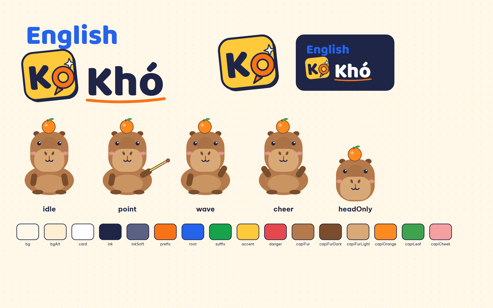

# English Ko Khó 🍊

> Tiếng Anh không khó: biết 1 gốc từ, hiểu cả họ từ.

Pipeline tự động dựng video ngắn (TikTok, YouTube Shorts) dạy từ vựng tiếng Anh theo gốc từ. Mỗi tập chỉ cần một file `episode.json`; một lệnh sẽ ra video 1080×1920 đã có watermark, intro, outro kêu gọi theo dõi, ảnh bìa và bộ status để đăng.



## Cài đặt (1 lần)

Cần Node.js ≥ 20, Python 3.12, FFmpeg (đã kiểm tra trên Windows 11).

```bash
npm install
pip install -r requirements.txt
copy .env.example .env          # rồi điền ZIPVOICE_URL + ZIPVOICE_API_KEY
npx remotion skills add         # Agent Skills của Remotion cho Claude Code (tuỳ chọn)
```

## Làm một tập

Mỗi tập nằm trên một nhánh riêng `episode/<id>`; `master` chỉ chứa phần dùng chung (chi tiết ở `CLAUDE.md` → Quy ước nhánh).

```bash
git checkout master && git pull && git checkout -b episode/005-scrib
```

```bash
# 1. Soạn nội dung (nhờ Claude Code: "soạn tập 5, gốc -SCRIB-" → skill ekk-episode)
#    -> episodes/005-scrib/episode.json, sau đó tự kiểm chứng từng từ và đặt verified: true
python scripts/validate_episode.py 005-scrib

# 2. Duyệt nhanh
python scripts/build.py 005-scrib --preview

# 3. Bản cuối + bộ đăng bài
python scripts/build.py 005-scrib --strict
```

Kết quả nằm trong `out/005-scrib/`:

| File | Nội dung |
| --- | --- |
| `005-scrib.mp4` | Video cuối: H.264/AAC, 30 fps, -14 LUFS |
| `cover.png` | Ảnh bìa TikTok / Shorts |
| `post.md` | **Status đăng**: caption TikTok, tiêu đề + mô tả YouTube, hashtag, bình luận ghim, đáp án đăng sau 24h, cài đặt nhãn AI, checklist |
| `anki.csv` | Flashcard để tự ôn |
| `qa.txt` | Kết quả kiểm tra thông số xuất bản |

Xem và chỉnh trực quan: `npm run dev` → composition `EpisodeVideo` → đặt `episodeId`.

## Cấu trúc một video

| Cảnh | Thời lượng | Nội dung |
| --- | --- | --- |
| Hook | ~3 s | Tất cả từ bay vào, mảnh gốc sáng lên |
| **Intro** | 1.3 s | Brand sting: logo + Capi, đặt *sau* hook để không mất người xem ở 3 giây đầu (đổi bằng `intro.position`) |
| Gốc từ | ~3 s | -SPECT- · Latin · = nhìn |
| Từng từ | ~6–8 s/từ | Ghép mảnh có màu + nghĩa từng mảnh, IPA, nghĩa, câu ví dụ giọng bản ngữ |
| Tổng kết | ≥ 4.5 s | Bảng để chụp màn hình |
| Câu đố | ~5 s | Từ mới cùng gốc, mời bình luận |
| **Outro** | ≥ 4 s | Kêu gọi theo dõi: thẻ kênh, nút Theo dõi tự bấm, Capi vẫy tay |

**Watermark** (mark "Ko" + `@englishkokho`) nằm suốt video ở góc trên trái, ngoài vùng UI của TikTok và Shorts. Phụ đề hiện như lời Capi nói.

## Giọng đọc

Kết quả thử server ZipVoice ngày 22/10/2026 (ASR PhoWhisper chấm phần tiếng Việt):

| Vai trò | Giọng | Ghi chú |
| --- | --- | --- |
| Lời dẫn tiếng Việt | ZipVoice `vv_sample` | Giọng "vv" anh/chị đã chọn. Phần tiếng Việt ASR khớp 91–100% |
| Từ + câu ví dụ tiếng Anh | edge-tts `en-US-AvaMultilingualNeural` | ZipVoice đọc tiếng Anh theo kiểu Việt ("inspect" thành "in spech"), nên tách sang giọng bản ngữ bằng cú pháp `[en:...]` |
| Dự phòng tiếng Việt | edge-tts `vi-VN-HoaiMyNeural` | Khi server tắt: `--allow-fallback` |

Một số giọng có sẵn trên server cũng hợp với kênh: `nu_studio_vixtts` (trợ lý, rõ, nhanh), `nu_bac_doc_tin` (studio, chuẩn), `nam_bac_lao_cai` (nam trầm). Đổi giọng ở `config/brand.json` → `voice.vi.voice`.

Lưu ý về giấy phép: edge-tts dùng dịch vụ đọc của Microsoft Edge, điều khoản không nói rõ việc dùng cho mục đích thương mại. Khi kênh bắt đầu kiếm tiền, nên chuyển giọng Anh sang Kokoro-82M (Apache 2.0, chạy offline) hoặc dùng server tự host nếu hỗ trợ tiếng Anh.

## Tài liệu

- `documents/Content_Plan.md`, `documents/Technology_Plan.md`: kế hoạch gốc
- `brand/BRAND.md`: logo, Capi, màu, font, giọng văn
- `config/episode.schema.json`: mô tả từng trường của episode.json
- `.claude/skills/ekk-*`: quy trình cho Claude Code (soạn, dựng, đăng)
